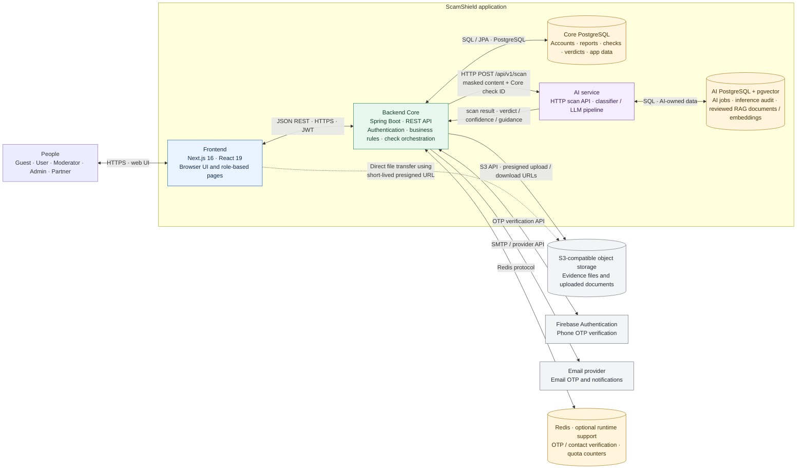

# ScamShield System Architecture

## Overview

ScamShield is a web application with a Next.js frontend, a Spring Boot Core API, and a separate AI scanning service. The Core API owns application workflows and the primary PostgreSQL database. It calls the AI service for scam analysis and uses S3-compatible object storage for uploaded evidence. The AI service owns its own PostgreSQL database, designed to use `pgvector` for retrieval-augmented analysis; the AI database is separate from the Core database.

**Diagram key:** solid arrows show synchronous application/API or storage interactions. The dotted browser-to-object-storage line shows direct file transfer after the Core API issues a short-lived presigned URL. The browser does not receive database access.

## Component explanations

| Component | Responsibility | Data and boundary |
| --- | --- | --- |
| People and roles | Use public checks and education pages, or sign in to user, moderator, administrator, and partner features. | Interact through the web frontend; role permissions are enforced by the Core API. |
| Frontend (Next.js) | Renders the ScamShield web application, collects user input, and calls feature-specific REST services. | Calls the Core API over HTTPS. For evidence uploads, it can transfer file bytes directly to object storage using a presigned URL from the API. |
| Backend Core (Spring Boot) | Provides REST endpoints and owns authentication, authorization, validation, business rules, reports, quotas, scam-check orchestration, and user-facing results. | The trusted application boundary between the browser, databases, AI service, and external providers. Sends masked scan input to the AI service. |
| Core PostgreSQL | Primary relational store for application and business data, including accounts, reports, check requests/history, and final user-facing verdicts. | Owned and accessed by Backend Core. AI data is not stored here as a cross-database foreign key; the Core check ID is passed as a reference. |
| AI service | Receives scan requests and produces a risk verdict, confidence, explanation, and safety guidance. The integration in Core calls `POST /api/v1/scan` and maps the response to a ScamShield verdict. | Separate service boundary, called over HTTP. Receives masked content and the Core check ID; Core remains responsible for the final application workflow and response. |
| AI PostgreSQL + pgvector | Stores AI jobs and inference audit records. The documented AI design also stores reviewed RAG documents, chunks, and embeddings for semantic retrieval. | Owned by the AI service and isolated from Core PostgreSQL. `pgvector` supports similarity search over approved knowledge chunks; it is not a file/object store. |
| S3-compatible object storage | Holds uploaded report evidence and other file objects. | Backend issues scoped, short-lived presigned URLs; the browser can upload directly. Core stores application metadata and object references, while file bytes remain in the bucket. |
| Firebase Authentication | Verifies phone numbers through the phone OTP flow. | External identity provider called by Backend Core; Core handles ScamShield account creation and authorization. |
| Email provider | Delivers email OTP and application messages when configured. | External delivery service called by Backend Core. |
| Redis (optional runtime support) | Provides fast-lived OTP/contact-verification state and quota counters where Redis-backed implementations/configuration are enabled. | Runtime cache/counter store, separate from durable relational data. In-memory implementations also exist for some flows. |

## Main connections and flows

### Scam check

1. The user submits a phone number, URL, message, or other supported input through the Next.js frontend.
2. The frontend sends the request to the Core REST API. Core validates the request and applies authentication, quota, and business rules.
3. Core checks its own data and rules, then calls the AI service for analysis when needed. The AI request includes the Core check ID and masked input.
4. The AI service runs its analysis and may use reviewed reference material from its own PostgreSQL/pgvector database.
5. The AI service returns a scan result. Core maps it to the application verdict, persists the check and result in Core PostgreSQL, and returns the response to the frontend.

### Evidence upload

1. The frontend asks Core for a presigned upload URL.
2. Core signs a scoped URL with the object-storage service and returns it to the frontend.
3. The frontend uploads the evidence bytes directly to the bucket using that URL.
4. The frontend submits the report with the resulting object reference. Core validates and stores report/evidence metadata in Core PostgreSQL.

### Phone verification

1. The frontend requests a phone OTP flow through Core.
2. Core coordinates OTP verification with Firebase and records/validates the resulting ScamShield verification state.
3. Core returns the outcome to the frontend. A verified external phone number does not itself grant a ScamShield role; Core controls account and role authorization.

## Data ownership and deployment notes

- Core PostgreSQL and AI PostgreSQL are distinct databases with separate ownership. The AI schema uses the Core check ID as an external reference and intentionally has no cross-database foreign key.
- The AI database design includes pgvector-backed RAG tables. This describes the intended AI persistence boundary; it should not be read as evidence that the AI database is provisioned by the current backend Docker Compose file.
- In the Core schema, the current local Compose file provisions Core PostgreSQL and Redis; the Core API is configured to call an AI service at `http://localhost:8000` by default, but AI service deployment is outside that Compose setup.
- The backend uses the AWS S3 SDK and supports S3-compatible configuration. Existing implementation and API descriptions refer to Supabase Storage as the configured S3-compatible provider. “S3 bucket” in this diagram means the object-storage interface/bucket; the actual provider and bucket names come from deployment configuration.
- Firebase phone verification and email delivery are external integrations, not databases owned by ScamShield.
